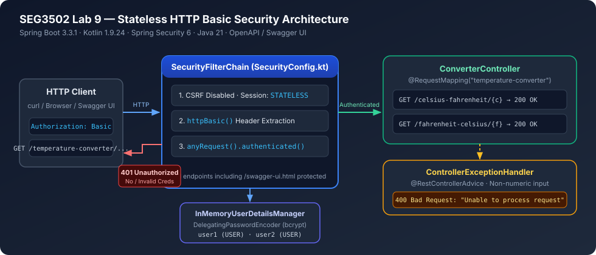
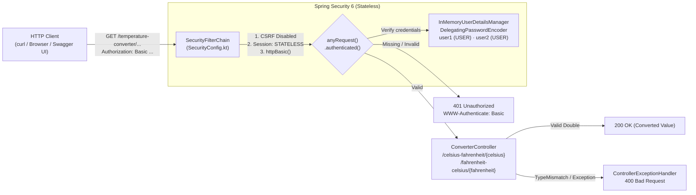
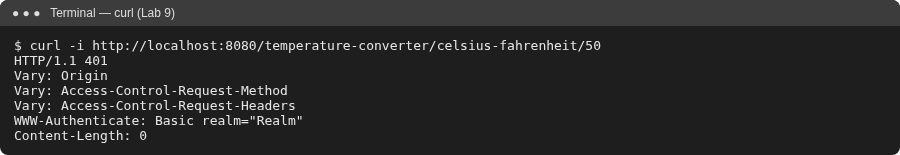
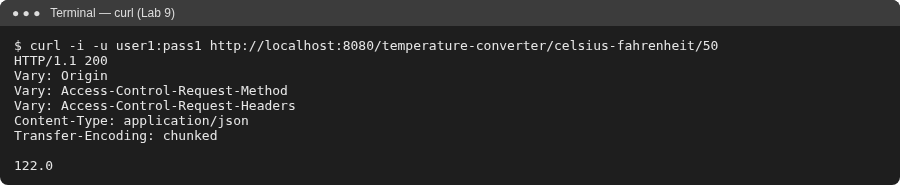
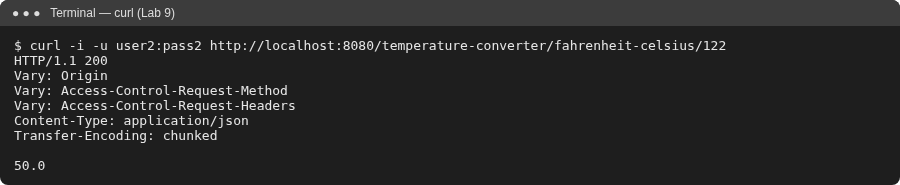
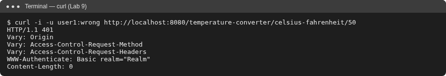
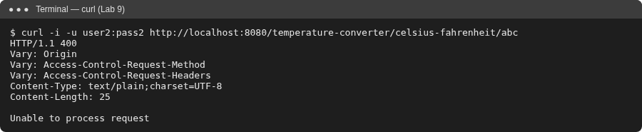
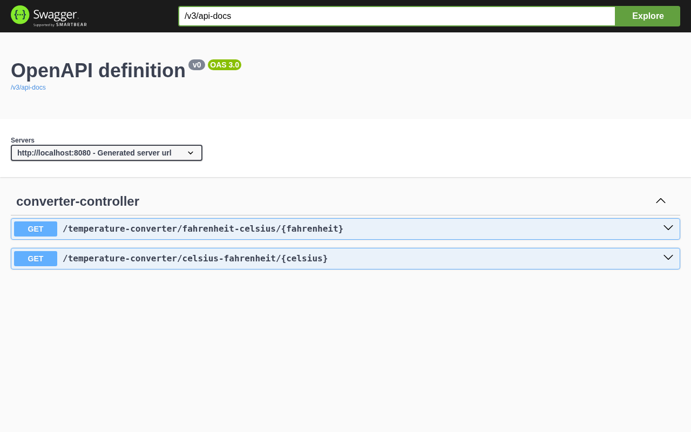

# SEG3502 — Lab 9: Spring Security (Stateless HTTP Basic API)

> **Course:** SEG3502 — Distributed Software Design (*Conception de logiciels distribués*)  
> **Authors:** Anwar & Manasse  
> **Status:** Verified locally with `./gradlew test` (4/4 MockMvc security integration tests passing on Java 21)

---

## English Summary

This project secures a Kotlin/Spring Boot REST API (`temp-converter-api`) using **Spring Security 6** with **in-memory authentication** (`InMemoryUserDetailsManager`) and **stateless HTTP Basic authentication**. Every endpoint—including OpenAPI/Swagger UI—requires valid credentials (`anyRequest().authenticated()`), CSRF protection is disabled for stateless REST usage, and passwords are encoded via `PasswordEncoderFactories.createDelegatingPasswordEncoder()`.

## Résumé en français

Ce projet sécurise une API REST Kotlin/Spring Boot (`temp-converter-api`) avec **Spring Security 6**, une authentification **en mémoire** (`InMemoryUserDetailsManager`) et l'authentification **HTTP Basic sans état** (*stateless*). Toutes les requêtes—y compris Swagger UI / OpenAPI—exigent des identifiants valides (`anyRequest().authenticated()`), la protection CSRF est désactivée pour un usage REST sans session, et les mots de passe sont hachés via `DelegatingPasswordEncoder`.

---

## Architecture





---

## Tools, Skills & Stack

| Category | Technologies & Implementations |
|---|---|
| **Backend & Language** | Kotlin `1.9.24`, Java `21` toolchain, Spring Boot `3.3.1`, Spring Web |
| **Security** | Spring Security (`spring-boot-starter-security`), `SecurityFilterChain`, `InMemoryUserDetailsManager`, `DelegatingPasswordEncoder`, stateless `SessionCreationPolicy.STATELESS`, HTTP Basic |
| **API Documentation** | `springdoc-openapi-starter-webmvc-ui:2.5.0` (`/swagger-ui.html`, `/v3/api-docs`) |
| **Build & Testing** | Gradle `8.8` (Kotlin DSL `build.gradle.kts`), JUnit 5, `MockMvc`, `spring-security-test` (`httpBasic()`) |

---

## Project Structure

- `src/main/kotlin/seg3x02/tempconverterapi/TempConverterApiApplication.kt` — Spring Boot entrypoint
- `src/main/kotlin/seg3x02/tempconverterapi/security/SecurityConfig.kt` — `PasswordEncoder`, `UserDetailsService` (`user1`/`user2`), and `SecurityFilterChain`
- `src/main/kotlin/seg3x02/tempconverterapi/controller/ConverterController.kt` — Temperature conversion REST endpoints
- `src/main/kotlin/seg3x02/tempconverterapi/controller/ControllerExceptionHandler.kt` — Global `@RestControllerAdvice` returning HTTP `400` on invalid input
- `src/test/kotlin/seg3x02/tempconverterapi/TempConverterApiApplicationTests.kt` — 4 MockMvc integration tests
- `docs/CASE_STUDY.md` — Engineering design notes & security trade-offs
- `docs/PROOF_OF_WORK.md` — Reproducible test & verification evidence

---

## Quick Start & Verification (Java 21)

```bash
git clone https://github.com/Anwarito-lbd/SEG3502-Lab9.git
cd SEG3502-Lab9

# Run automated MockMvc security tests (Windows: .\gradlew.bat test)
./gradlew test

# Start the API server (Windows: .\gradlew.bat bootRun)
./gradlew bootRun
```

### Manual Endpoint Checks (`curl` & Swagger UI)

```bash
# 1. Unauthenticated request -> 401 Unauthorized
curl -i http://localhost:8080/temperature-converter/celsius-fahrenheit/50

# 2. Valid user1 credentials -> 200 OK (122.0)
curl -u user1:pass1 http://localhost:8080/temperature-converter/celsius-fahrenheit/50

# 3. Valid user2 credentials -> 200 OK (50.0)
curl -u user2:pass2 http://localhost:8080/temperature-converter/fahrenheit-celsius/122

# 4. Invalid password -> 401 Unauthorized
curl -i -u user1:wrong http://localhost:8080/temperature-converter/celsius-fahrenheit/50

# 5. Non-numeric input -> 400 Bad Request ("Unable to process request")
curl -i -u user2:pass2 http://localhost:8080/temperature-converter/celsius-fahrenheit/abc
```

Swagger UI (browser prompts for Basic Auth credentials): `http://localhost:8080/swagger-ui.html`

---

## Visual Verification Gallery

| Unauthenticated (`401`) | Authenticated `user1` (`200`) | Authenticated `user2` (`200`) |
|---|---|---|
|  |  |  |

| Wrong Password (`401`) | Invalid Input (`400`) | Swagger UI (Authenticated) |
|---|---|---|
|  |  |  |
